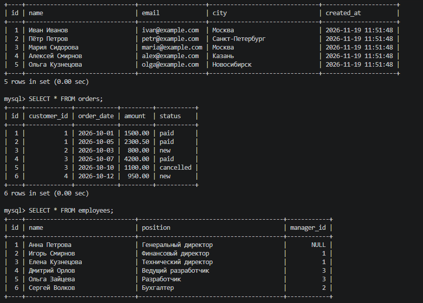
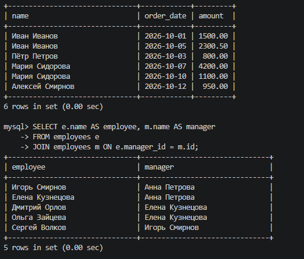
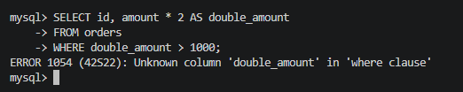
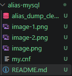
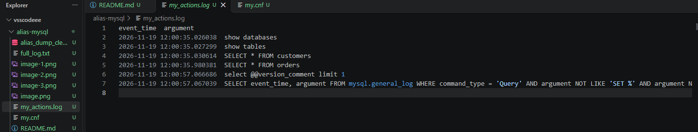

# Лабораторная работа: Алиасы в SQL (с ведением лога)

## Цель работы
Изучение механизма алиасов (псевдонимов) для таблиц и столбцов в SQL, а также ведение и фильтрация лога действий пользователя.

## Ход работы
1. Создана база `alias_db` и таблицы `customers`, `orders`, `employees`.
2. Заполнены таблицы тестовыми данными.
3. Выполнены запросы с использованием алиасов:
   - Алиасы таблиц в JOIN.
   - Самосоединение (обязательный алиас).
   - Алиасы столбцов для агрегатов.
   - Алиас в ORDER BY.
   - Демонстрация ошибки при использовании алиаса в WHERE.
   - Алиас для производной таблицы (подзапрос в FROM).
4. Создан дамп базы (`alias_dump_clean.sql`).
5. Выгружен лог действий (`my_actions.log`).

## Скриншоты

### Создание БД и таблиц

### Самосоединение

### Ошибка алиаса в WHERE

### Файл дампа

### Файл лога

## Результаты
В папке проекта находятся:
- `alias_dump_clean.sql` — дамп базы данных `alias_db`.
- `my_actions.log` — отфильтрованный лог действий пользователя.